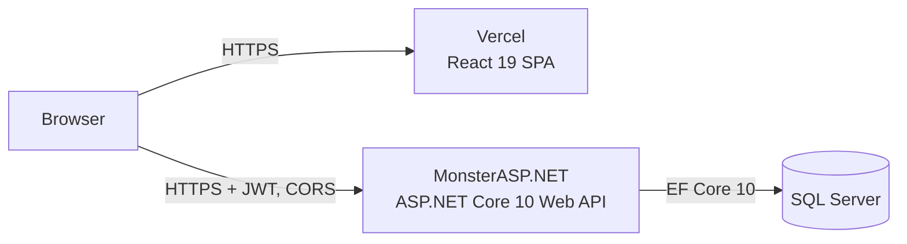

# Employee Management System

A full-stack employee management application built to demonstrate production-ready
.NET and React practices: clean architecture, JWT security, validation, testing,
and a real deployment.

**Live demo:** https://employee-management-liard-six.vercel.app
<!-- If you created a read-only demo account, add it here:
**Demo login:** `demo` / `<password>` (read-only User role; data is fictional) -->

## Architecture



| Layer | Project | Responsibility |
|---|---|---|
| Core | `EmployeeManagement.Core` | Entities, enums; no dependencies |
| Application | `EmployeeManagement.Application` | Services, DTOs, validation, Result pattern, interfaces |
| Infrastructure | `EmployeeManagement.Infrastructure` | EF Core, repositories, migrations, JWT, password hashing |
| API | `EmployeeManagement.API` | Controllers, auth, middleware, Problem Details, logging |
| Client | `client/` | React (Vite), React Router, Axios, Bootstrap |

## Features

- Employee CRUD with search, department and status filters, sortable columns, and pagination (state kept in the URL)
- Department management with protection against deleting departments that still have employees
- Dashboard with totals and employee distribution by department
- JWT authentication with Admin and User roles; secure-by-default authorization
- Validation on client, API (FluentValidation), and database (constraints)
- Consistent RFC 7807 Problem Details errors with trace ids

## Security and production practices

- PBKDF2 password hashing, timing-equalized login failures, login rate limiting
- Fallback authorization policy, capability-based policies
- HSTS, CSP, and security headers on API and frontend; CORS restricted to the frontend origin
- Startup validation of configuration; secrets never committed
- Structured logging with Serilog, request logs, trace-id correlation
- EF Core connection resiliency; indexes tuned against 50,000 rows

## Tech stack

.NET 10, ASP.NET Core Web API, EF Core 10, SQL Server, FluentValidation, Serilog,
React 19, Vite, React Router, Axios, Bootstrap 5, xUnit, WebApplicationFactory, Postman.

## Running locally

**Prerequisites:** .NET 10 SDK, SQL Server (Developer or Express), Node.js 22.12+.

```powershell
# API secrets (development only)
dotnet user-secrets set "Jwt:SigningKey" "<base64 64-byte key>" --project src/EmployeeManagement.API
dotnet user-secrets set "SeedAdmin:Password" "<password>" --project src/EmployeeManagement.API

# Database
dotnet ef database update --project src/EmployeeManagement.Infrastructure --startup-project src/EmployeeManagement.API

# API (https://localhost:7294, Swagger at /swagger)
dotnet run --project src/EmployeeManagement.API --launch-profile https

# Client (http://localhost:5173)
cd client
npm install
npm run dev
```

Update the connection string in `src/EmployeeManagement.API/appsettings.Development.json` for your SQL Server.

## Tests

```powershell
dotnet test
```

Integration tests start the real API in memory against a dedicated `EmployeeManagementDb_Tests`
database rebuilt from migrations on every run. A Postman collection with a role matrix is in `tests/postman/`.

## Documentation

- [Configuration](docs/configuration.md)
- [Security review](docs/security.md)
- [Performance review](docs/performance.md)
- [Deployment runbook](docs/deployment.md)
- [Smoke test](docs/smoke-test.md)
- [Defect log](docs/defect-log.md)